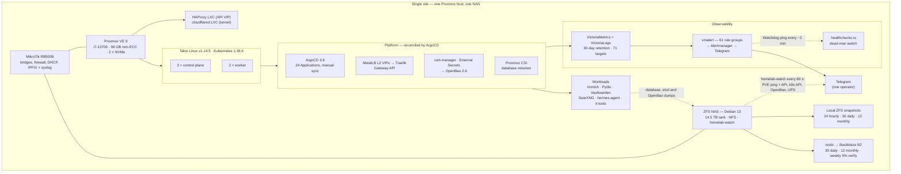
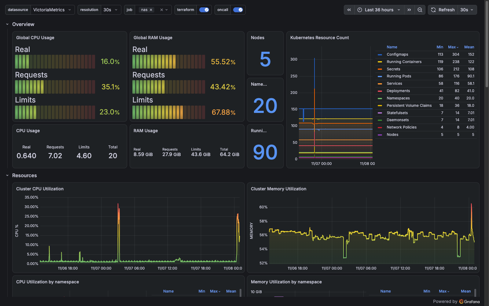
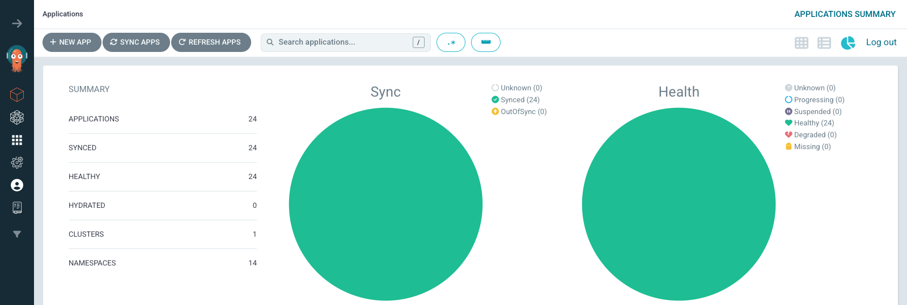
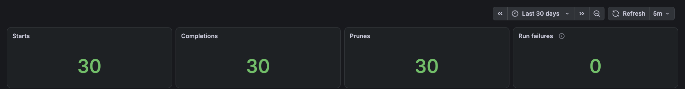
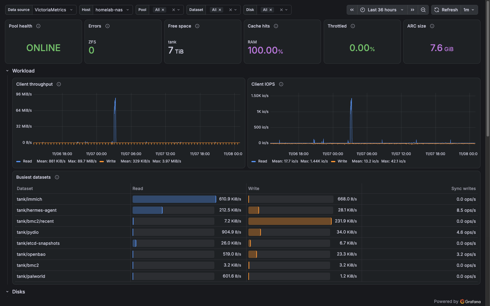
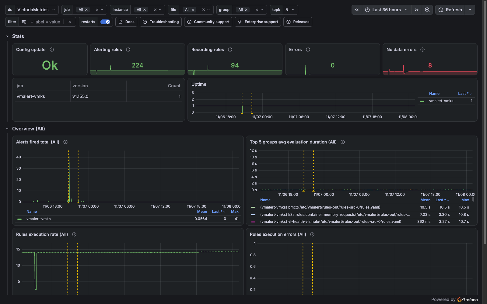

# Homelab — a small platform, operated like production

This is a five-node Kubernetes cluster running on a single Proxmox VE host, with a
ZFS NAS for storage, built to practise the parts of platform work that a managed
cloud hides: state and credentials, upgrades that cannot be rolled back, backups
that have to be restored to be believed, and alerts that must still fire when the
thing that sends them is down. Everything is declared in Git: Terraform goes
through plan-only CI and a guarded local apply, Kubernetes manifests are reconciled
by ArgoCD with **manual sync only**, and a small bootstrap set is applied by hand.
Detail comes from an in-cluster metrics/log stack; the alarm that says the cluster
is gone comes from outside it. The interesting part is not the hardware — it is the
operating discipline: measure before removing, backtest alert rules against a real
incident, and treat every incident as a change request rather than a story.

The production repository is private. This repository contains sanitized excerpts,
four decision records, and three blameless post-mortems. Hostnames, addresses and
identifiers are placeholders (`example.net`; `10.0.10.0/24` for the LAN,
`10.200.0.0/16` for pods, `10.201.0.0/16` for services); versions and counts are
real.

Built and operated by [@b0riswu](https://github.com/b0riswu).

## At a glance

- **5 Talos nodes** (3 control planes + 2 workers) on one Proxmox VE host; Kubernetes 1.36.6, etcd 3.7.3.
- **24 ArgoCD Applications** (23 services + the root), all `Synced/Healthy`, all manual-sync.
- **71 scrape targets**, 61 vmalert rule groups, 30 days of metrics in VictoriaMetrics and logs in VictoriaLogs.
- **3 backup layers** — ZFS snapshots, restic to B2 (30 nightly runs in 30 days, 0 failures), application-consistent dumps.
- **5 post-mortems written, 3 published**; 4 decision records; timed restore drills are listed, and the drills still missing are named.

The hardest problem so far was a host that froze silently for ~29 hours while ICMP
and TCP stayed green; finding it forced the out-of-band NAS poller and the external
dead-man switch.

## How to read this

| Document | One-line takeaway |
|---|---|
| [Architecture](docs/architecture.md) | Eight views: hardware, network, Kubernetes layers, change flow, secrets, observability, backup, upgrade path. |
| [Screenshots](docs/screenshots.md) | Live dashboards from 2026-11-08, with captions. |
| [ADR 0001](docs/decisions/0001-opentofu-encrypted-state-in-b2.md) | State is encrypted client-side in B2 — and losing one passphrase loses that module's state. |
| [ADR 0002](docs/decisions/0002-argocd-manual-sync.md) | App-of-apps with manual sync: provenance is a query, drift is visible, nothing self-heals. |
| [ADR 0003](docs/decisions/0003-remove-rancher.md) | Rancher hit a Kubernetes version ceiling, was measured for nine days, and was removed. |
| [ADR 0004](docs/decisions/0004-talos-immutable-nodes.md) | Talos: no SSH, node config as data, upgrades as lifecycle calls instead of package rituals. |
| [Post-mortem 2026-09-05](docs/postmortems/2026-09-05-pve-silent-freeze.md) | A 29-hour silent freeze that no in-cluster check could see. |
| [Post-mortem 2026-11-03](docs/postmortems/2026-11-03-pods-stuck-terminating.md) | A six-month-old mount made pods immortal; two alert rules were backtested against it. |
| [Post-mortem 2026-11-04](docs/postmortems/2026-11-04-metallb-vip-withdrawal.md) | One copied label withdrew every VIP; a five-minute health check now catches it. |

## Architecture



Two rules shape this diagram. Observability runs **inside** the cluster for
detail, but the alert that says "the cluster is gone" runs **outside** it (NAS
poller plus an external dead-man switch). And the backup chain has three layers
because each one fails differently: ZFS snapshots for fast local rollback, restic
to B2 for site loss, and application-consistent dumps for databases that cannot be
restored from a block-level copy alone.

More views — hardware and failure domains, network paths, Kubernetes layers, the
change flow, secrets, observability, backup and the upgrade path — are in
[`docs/architecture.md`](docs/architecture.md).

## In operation

Live dashboards, captured 2026-11-08 (metrics over the last 36 hours, backups over
30 days; identifiers replaced before capture). More, with captions:
[`docs/screenshots.md`](docs/screenshots.md).



| | |
|---|---|
|  |  |
|  |  |

## Stack

| Layer | Component | Version | Why it is here |
|---|---|---|---|
| Virtualisation | Proxmox VE | 9.2.x | One host, VMs for nodes, `local-lvm` for CSI volumes |
| OS / Kubernetes | Talos Linux / Kubernetes | v1.14.5 / 1.36.6 | Immutable, API-driven nodes; no SSH, config in Terraform |
| IaC | OpenTofu + B2 backend | 1.13.9 | Client-side state encryption (Terraform has none) |
| GitOps | ArgoCD | 3.6.0 | Commit-level provenance for "what was running when" |
| Ingress | MetalLB (L2) + Traefik + Gateway API | 0.16.1 | VIPs on the LAN; public HTTP enters through the router, the PVE UI through an outbound-only tunnel |
| Secrets | OpenBao + External Secrets Operator | 2.6.3 / 2.14.0 | Central machine-secret store, per-app ACLs, audit log |
| Certificates | cert-manager + private CA | — | Internal TLS, short-lived operator webhook certs |
| Storage | Proxmox CSI, NFS, ZFS | — | Database volumes on PVE; bulk files on the NAS |
| Observability | VictoriaMetrics + VictoriaLogs | chart 0.97.1 | 30 days of metrics and logs, one Grafana entry point |
| Alerting | vmalert → Alertmanager → Telegram | — | 61 rule groups; Watchdog pings healthchecks.io |
| Backup | ZFS snapshots, restic, CronJobs | — | Three layers, all with a documented restore path |
| Automation | Ansible, MikroTik RouterOS | — | Host roles (journal upload, ZFS, restic), router config |
| CI | GitHub Actions | — | `tofu fmt/init/validate/plan` only; never apply |

## Design principles

**Git is the source of truth, and the deployment record is queryable.** The
question that started the GitOps work was concrete: given a database backup from
a given night, which manifest version was running? `git log --before=<backup time>`
answers that only if the git HEAD equals what is deployed — an assumption that had
already been false once. ArgoCD records the revision it actually synced and when,
so provenance becomes a query instead of an inference.

**Plan-only CI, guarded local apply.** CI has read-only credentials and never
applies. Apply runs from the main checkout, on `main`, at `origin/main`, with a
clean `terraform/` tree, through one wrapper that also serialises runs with a lock
(B2 rejects the conditional write the S3 lockfile needs) and can freeze a module
during a secret rotation. The code being applied is exactly the code that merged —
unless the documented rollback override (`TF_ALLOW_BRANCH_APPLY=1`) is used.

**Manual ArgoCD sync, on purpose.** No `automated`, no `selfHeal`, no `prune`.
Manual `kubectl` changes show up as `OutOfSync`, which is the point. `prune` stays
off for anything with data: a Proxmox CSI volume is a single copy with
`reclaimPolicy: Retain`, so a mistaken prune is a restore event, not a resync. The
cost is discipline, and one incident showed the limit of the guarantee: ArgoCD only
knows about objects in Git — deleting an "orphan" ServiceAccount that owned 41
generated alert-rule groups left ArgoCD green while the default alerts were
silently garbage-collected for 19 minutes.

**Measure before removing.** Rancher was removed after 9 days of instrumentation:
2 logins, 0 UI changes, 0 Fleet GitRepos, 0 CAPI clusters — against ~2.8 GiB of
memory, 94 CRDs, and 24.5% of API-server watch traffic, and a version ceiling below
the Kubernetes release being adopted. Same rule for alert rules: two new rules were
backtested against seven days of real data before being merged.

**Backups are drills, not jobs.** Every layer has a restore procedure and, where
possible, a timed drill: Vaultwarden (2026-08-02), Immich (2026-10-05, `pg_restore`
in 14 s with matching row counts), and an OpenBao snapshot restore into a
disposable kind cluster from an offline key in 6 min 46 s. The production OpenBao
restore has not been drilled, and services without a drill are named as such and
keep `prune` disabled indefinitely.

**Assume the monitoring dies with the patient.** Every in-cluster check shares the
cluster's fate. The NAS poller and the healthchecks.io Watchdog exist because a
host freeze once went unnoticed for 29 hours while ICMP and TCP were still green.

## Numbers

| Claim | Number | Evidence |
|---|---|---|
| Cluster | 5 Talos nodes (3 control plane + 2 workers) | `talosctl version`, 2026-11-04 |
| Versions | Talos v1.14.5, Kubernetes v1.36.6, etcd 3.7.3 | upgrade record L0–L4 |
| Kubernetes upgrade | 1.35.10 → 1.36.6 in 6 min 18 s, no user-facing outage | `talosctl upgrade-k8s`, 2026-11-04 |
| GitOps | 24 ArgoCD Applications (23 services + root), all `Synced/Healthy`, all manual | `kubectl -n argocd get applications` |
| Scrape targets | 71 | `up`, 71/71 |
| Alert rule groups | 61 in vmalert | post-recovery check |
| Out-of-band checks | Watchdog → healthchecks.io (~2 min), NAS poller every 60 s | live config |
| Post-mortems | 5 written; 3 published here | vault project notes |
| Alert backtest | 2 rules, 7 days of data, fired at the right minutes | `pod-termination-alerts.yaml` |
| Log noise | auditd 12,482 → 80 lines/min at the Vector layer | VictoriaLogs query |
| Backup layers | 3: ZFS snapshots, restic → B2, DB/etcd/secret dumps | cron + CronJob inventory |
| Restore drills | Vaultwarden 2026-08-02; Immich 2026-10-05; OpenBao 6 min 46 s into a disposable kind cluster | drill notes |
| Credential rotation | whole cluster identity rotated in place; 48 s API/etcd blip, public endpoints 200 throughout | 2026-11-06 rotation log |
| Rancher removal | 2 logins in 9 days, 0 UI changes → freed ~2.8 GiB, 94 CRDs, 24.5% API-server watch | removal decision record |

## Limits

- **Single site, single Proxmox host.** Every node, the ingress VIP, OpenBao and
  the monitoring stack live on one physical machine. The 2026-09-05 freeze took
  everything down for ~29 hours. There is no second compute failure domain; the
  NAS is a separate storage and poller domain but shares the room, switch,
  internet path and UPS. No HA control plane across hosts.
- **No SLOs and no tracing.** Metrics and logs exist; latency objectives,
  error budgets and distributed traces do not. Alerting is symptom-based.
- **Solo operator.** The bus factor is one. Runbooks and post-mortems are the
  mitigation, not a substitute for a second pair of eyes.
- **NetworkPolicy is not enforced.** The CNI (Flannel) ignores NetworkPolicy, so
  namespace isolation is documentation, not a control. Database port exposure
  inside the cluster is an accepted, written-down gap.
- **Single-copy data.** Database volumes are one Proxmox CSI disk each with
  `Retain`; moving a pod is a re-attach, not a failover. Pydio has never had a
  restore drill, so it stays manual-sync and no-prune.
- **Non-ECC, mixed memory.** Four DIMMs from two vendors in two capacities, all
  running at 3200 MT/s, with no ECC. It is a standing suspect in two undiagnosed
  host freezes.
- **The origin does not yet authenticate Cloudflare.** No Authenticated Origin
  Pulls, no Access-JWT check: a request that reaches the origin is trusted on the
  router's source filter alone, which is not an access control. The fix
  (terminate TLS with client certificates, or verify the Access JWT at the edge
  proxy) is tracked.
- **Some host-level evidence is still missing.** netconsole, kdump and a serial
  console are designed but not enabled; the last two host incidents ended with
  "root cause undetermined" for exactly that reason.

## Repository map

```
docs/
  architecture.md     eight views: hardware, network, layers, flow, secrets, observability, backup, upgrade
  screenshots.md      live dashboards (Grafana, ArgoCD) with captions
  images/             the screenshots
  decisions/          four ADR-style records (context / decision / consequences)
  postmortems/        three blameless post-mortems
examples/
  opentofu/           encrypted B2 backend, module layout, apply-guard wrapper
  .github/workflows/  plan-only Terraform CI
  argocd/             app-of-apps root + one Application
  monitoring/         VMRule alert rules, backtested against an incident
  ansible/            restic backup script (alerting, shrink guard, verify)
  talos/              machine-config patches, incl. the label that broke MetalLB
```

The private source repository is laid out as `terraform/{infra,talos,cloudflare}`,
`kubernetes/{infrastructure,argocd-apps,tools,media,networking,openbao,traefik,games,secrets,archive}`,
`ansible/{playbooks,roles}`, and `mikrotik/{changes}`; Pydio lives under
`kubernetes/tools/`, and several directories carry their own `docs/`. The excerpts
here are re-rooted under `examples/`, with the upstream path recorded in each
file's header comment.
