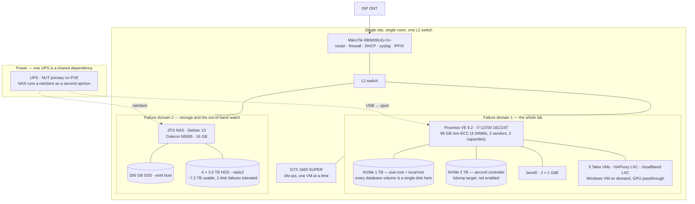
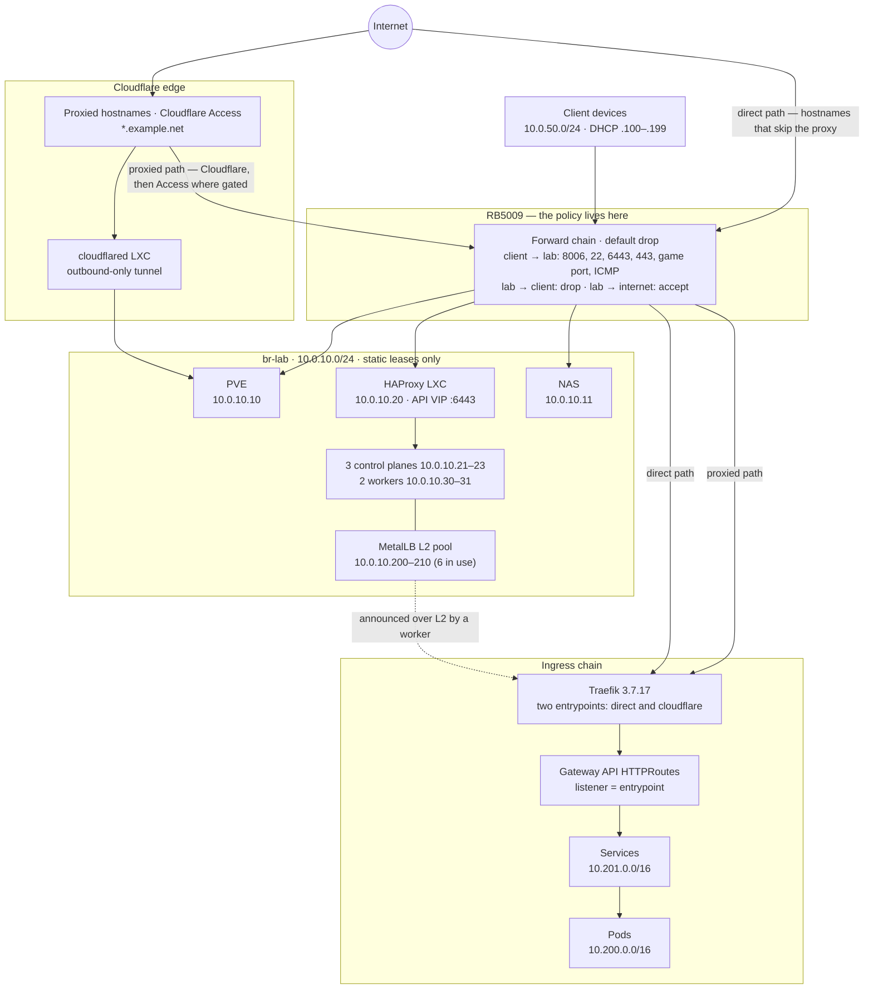
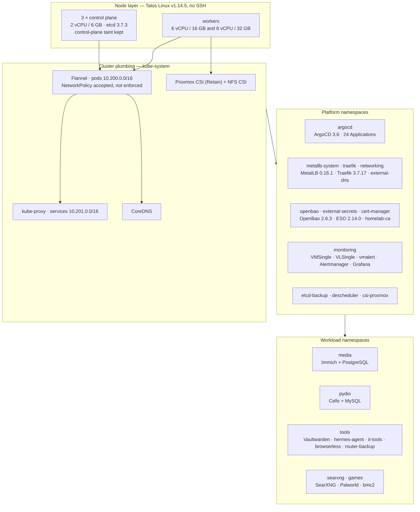
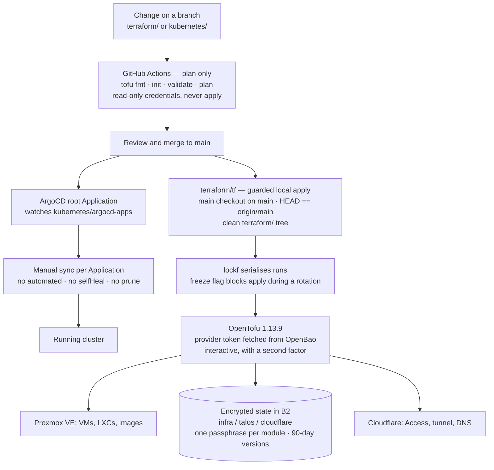
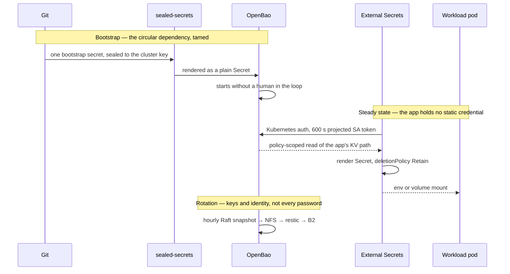
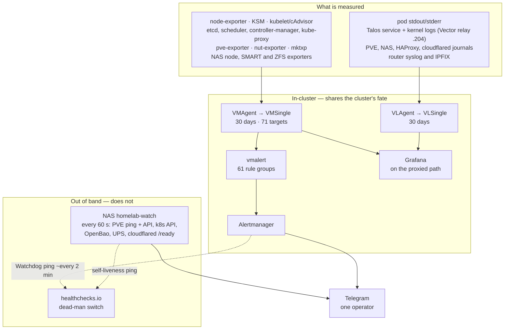
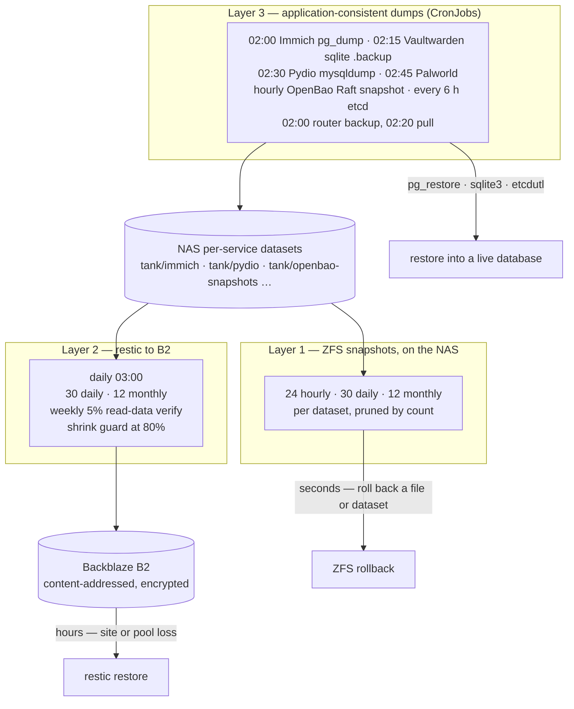
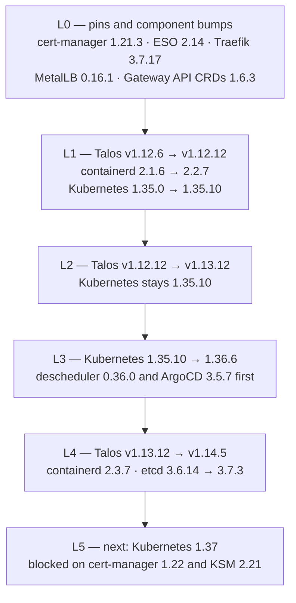
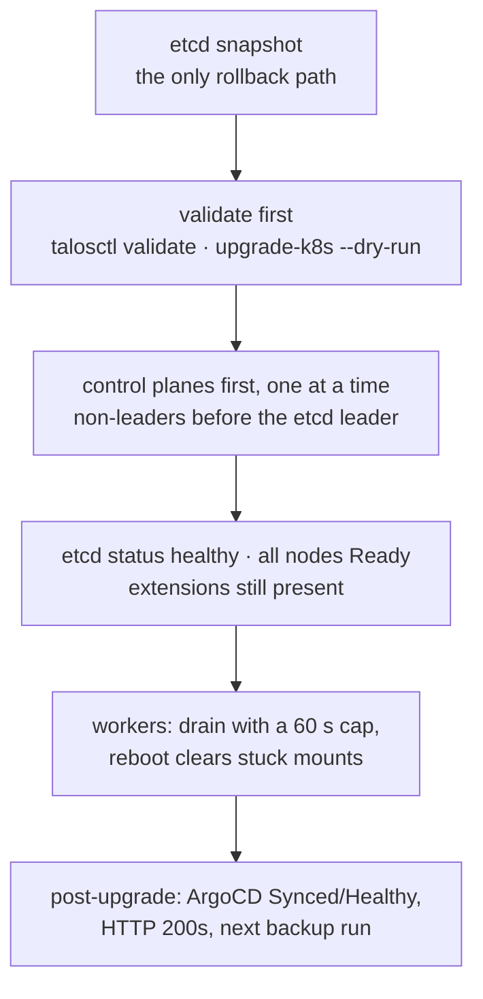

# Architecture — eight views of one small platform

The [README](../README.md) shows the system on one page. This document takes it
apart: hardware and failure domains, the network, the Kubernetes layers, how a
change travels from a pull request to a running pod, where secrets come from,
what watches the system when it is broken, how data is backed up and restored,
and the order in which the platform was upgraded.

Addresses and hostnames here are placeholders on the same scheme as the rest of
the repository: `10.0.10.0/24` is the lab LAN, `10.0.50.0/24` the client network,
`10.200.0.0/16` pods and `10.201.0.0/16` services. Versions, counts and
timestamps are real.

## 1. Physical and hardware view

This is a two-machine system, not a cluster with a spare: the Proxmox host holds
every VM, the API VIP, the tunnel and the monitoring stack, so a host freeze takes
the entire lab with it — which is exactly what happened for ~29 hours on
2026-09-05. The NAS is a separate failure domain, but only for storage and the
external poller; it shares the same room, switch, internet path and UPS. The two
NVMe drives sit behind different controllers so a kdump target exists, but kdump
is not enabled, and the 1 TB drive carries both the root filesystem and the LVM-thin
pool that backs every database volume — one disk, one copy.

## 2. Network view

There are two L2 segments and no 802.1Q VLANs: with a single host and one switch,
the segmentation that matters is the router's forward chain, which drops by
default and allows the ports the client network uses — including PVE UI, SSH, the
Kubernetes API, HTTPS to Traefik, RDP/Moonlight, the game port and ICMP — while the
lab may not initiate into the client network. Ingress has two paths on purpose.
Proxied hosts arrive on their own origin path through Cloudflare — the edge
terminates TLS, applies Access where the host is gated, and forwards to the
origin — while hostnames that would hit Cloudflare's request-size limit are served
directly from the origin. The PVE UI cannot sit behind Traefik, so it is reached
through the outbound-only tunnel. The proxied path does not authenticate Cloudflare
at the origin yet, and the direct path is public by construction. Inside the
cluster MetalLB announces the VIP pool over L2 and Traefik's Gateway listeners —
named after the entrypoints — fan out to HTTPRoutes.

## 3. Kubernetes platform layers

The layers are stacked so that each one can be reasoned about — and rebuilt — on
its own: Talos nodes with no SSH and a pinned Kubernetes version, then the CNI,
kube-proxy and CSI drivers that make pods and volumes work, then the platform
services in their own namespaces, then workloads that assume none of the platform
internals. Flannel is the deliberate weak point: the API accepts NetworkPolicy
objects and the CNI enforces nothing, so namespace isolation is documented intent
rather than a control. Database volumes are Proxmox CSI disks with `reclaimPolicy: Retain` and
bulk files are NFS, which is why a pod move is a re-attach and not a failover.

## 4. GitOps and IaC change flow

Two tracks share one merge: Kubernetes manifests go to ArgoCD, infrastructure goes
through OpenTofu, and neither applies itself. CI runs `plan` with credentials that
can read and nothing else, while `apply` happens only from the main checkout on
`main` at `origin/main` with a clean `terraform/` tree, through one wrapper that
serialises runs with a lock and can freeze a module mid-rotation. ArgoCD is manual
on purpose — `OutOfSync` after a hand edit is the signal that Git and the cluster
disagree — and `prune` stays off for anything holding data. State lives in B2,
encrypted client-side with one passphrase per module; provider tokens live in
OpenBao, and no long-lived Proxmox or Cloudflare credential sits on the workstation.

## 5. Secrets flow

Machine secrets live in OpenBao and reach pods only through External Secrets, with
a per-namespace `SecretStore` and a Kubernetes-auth role bound to one ServiceAccount,
each role restricted to that application's KV path with a read-only policy — so the
application path carries no static bootstrap credential. Sealed-secrets survives as
the bootstrap mechanism, plus a short exception list (the alert bot, ArgoCD's repo
credential); its own rotation was switched off at eight keys, which are backed up
GPG-encrypted to B2 because losing one makes that era's SealedSecrets
undecryptable. Audit goes to stdout, and Raft snapshots are taken hourly so the
nightly restic run can carry them off-site; what is *not* automatic is database
password rotation, an accepted trade recorded as a known gap rather than hidden.

## 6. Observability and alerting paths

Metrics and logs are collected inside the cluster because that is where the detail
is, but nothing inside the cluster can report that the cluster is gone, so the
checks that matter most run on the NAS: every 60 seconds it probes the PVE host and
its API, the Kubernetes API, OpenBao and the UPS, and it pings healthchecks.io so
its own death is noticed too. In-cluster, vmalert evaluates 61 rule groups into
Alertmanager and Telegram, and a Watchdog alert exercises the whole path to
healthchecks.io about every two minutes. Log sources are deliberately broad — pod
output, Talos service and kernel logs through a per-node Vector port, host journals,
router syslog and IPFIX — because the 2026-09-05 freeze left no usable log at all
when journald shared a disk with the failing controller.

## 7. Backup and restore

Three layers exist because they fail differently: ZFS snapshots are fast and local
but die with the pool, restic is off-site and survives site loss but is slow to
restore, and the dumps capture database state that a block-level copy cannot make
consistent. Retention is 24 hourly / 30 daily / 12 monthly locally and 30 daily /
12 monthly off-site, with a weekly read-data check and a repo-shrink guard so a
failed mount cannot age good data out. Restores are treated as drills: Vaultwarden
and Immich have timed, verified restores into the live services; OpenBao's drill
restored a snapshot from an offline key into a disposable kind cluster, not into
the production cluster, so a production OpenBao restore is documented but not
drilled. etcd has been restored to a data directory but
not rebuilt into a cluster, and Pydio is named as never drilled.
`backup-monitor` checks `lastSuccessfulTime` daily and alerts to Telegram, because a
CronJob that never fired cannot report its own failure.

## 8. Upgrade path

Each OS hop — L1, L2 and L4 — runs the same gates:

The upgrade was planned as layers rather than one leap: pin and bump components
first (L0), then move the OS without moving Kubernetes (L1, L2), then move
Kubernetes on a stable OS (L3), then take the OS to 1.14 (L4) — each stage followed
by the same post-upgrade checks. On an OS hop the control planes go first and one
at a time because Talos's lifecycle upgrade does not guard etcd quorum, and the
etcd leader goes last; workers go afterwards with a short drain because a stuck
drain is an outage, not patience. The Kubernetes hop took 6 min 18 s with no user-facing
outage, and L4 moved etcd's on-disk version to 3.7.0, which makes "roll back to
1.13" a snapshot restore rather than a binary rollback.
