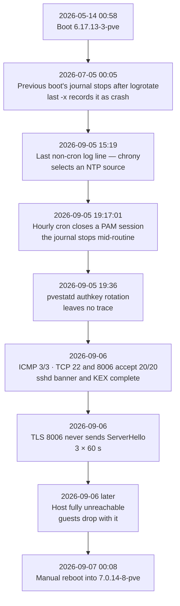

# 2026-09-05 — Proxmox host silently freezes for ~29 hours

| | |
|---|---|
| **What happened** | The Proxmox VE host stopped writing to disk mid-routine at 19:17 while the kernel kept answering the network; it was noticed only when it went fully offline and was rebooted by hand ~29 hours later. |
| **Impact** | Every guest was unavailable for ~29 hours with no alert, and the incident window left no usable log. |
| **What changed** | A NAS out-of-band poller (60 s, PVE ping + API, k8s API, OpenBao, UPS) and host journals shipped to VictoriaLogs; netconsole was designed, while kdump and the panic/watchdog decision remain open. |

## Summary

On 2026-09-05 at 19:17 the Proxmox VE host stopped writing to disk mid-routine,
with no warning and no error. The kernel kept scheduling and answering the network,
so every ICMP and TCP check stayed green while nothing on the host could read or
write storage. The host was noticed only when it went fully offline, and was
rebooted by hand on 2026-09-07 at 00:08 — roughly **29 hours** later.

This was the second identical failure: the same kernel had already crashed the same
way on 2026-07-05, 62 days earlier, and the boot before that had itself run for
52 days. The direct cause is established; the root cause is not, and cannot be
recovered from this host because the only journal device was the disk that died.

## Impact

- One Proxmox host = the entire lab. Every guest on it was unavailable: the five
  Kubernetes nodes, HAProxy (API VIP), cloudflared, and therefore every public
  hostname.
- **~29 hours of unavailability with no alert.** The first signal was a human
  noticing that a host was unreachable.
- Recovery was a manual reboot, not a restore. Data impact beyond availability was
  not recorded, and this write-up does not claim otherwise.
- There is **no usable log** from the incident window. journald wrote to the failing
  disk; the logging target disappeared at the same moment as the fault.

## Timeline (Asia/Taipei)

| Time | Event |
|---|---|
| 2026-05-14 00:58 | Boot, kernel `6.17.13-3-pve` (`last -x` shows this boot ended in `crash`) |
| 2026-07-05 00:05:06 | Previous boot's journal stops right after logrotate; boot record for that session is `crash` |
| 2026-09-05 15:19 | Last non-cron log line (chrony selecting an NTP source) |
| **2026-09-05 19:17:01** | Hourly cron closes a PAM session — **the journal stops mid-routine**, zero warnings, zero errors |
| 2026-09-05 19:36 | The daily `pvestatd` authkey rotation leaves no trace: the host was already dead |
| 2026-09-06 | Probes: ICMP 3/3, TCP 22 and 8006 accept 20/20, sshd sends a full banner and completes KEX; key-based auth is refused by the *server* (not `Permission denied`); TLS 8006 never sends ServerHello (3 × 60 s) |
| 2026-09-06 later | Host becomes fully unreachable; guests on it drop with it |
| 2026-09-07 00:08 | Manual reboot into `7.0.14-8-pve` |
| 2026-09-07 | `last -x` shows the earlier boots ending in `crash`; two silent freezes, 52 and 62 days apart, both on `6.17.13-3-pve` |

## Root cause

**Direct cause (established):** block I/O on the Samsung 980 PRO (then `nvme1`,
now `nvme0`) holding `pve-root` and the LVM-thin pool stopped entirely, while the
rest of the kernel kept running. The four probes converge on one precondition:

| Observation | Implication |
|---|---|
| ICMP 3/3, TTL 63 | network stack alive |
| TCP 22/8006 accept, sshd banner + KEX | fork, scheduler and listeners alive |
| SSH key auth refused, twice, 70 s apart | the authorized-keys file resolves through `/etc/pve` (pmxcfs) and was unreadable |
| TLS 8006 no ServerHello | `pveproxy` cannot read the certificate on `/etc/pve` |
| journald silent | its write target is gone |

Ruled out with evidence: disk full (25% used, 2% inodes), thin-pool exhaustion
(data 43.4%, metadata 1.6%), OOM (61 GB free, no OOM record), ext4 read-only
conversion (filesystem `clean`, no error count), disk failure (SMART
`Critical Warning 0x00`, media errors 0, spare 100%, fixed firmware), Raptor Lake
voltage instability (microcode `0x132` loaded on all three boots), a stuck backup
job (no `vzdump` task in the journal), and GPU passthrough (both passthrough VMs
were powered off; last `vfio-pci reset` was weeks earlier).

**Root cause (undetermined).** Two candidates remain and the dead disk is exactly
where the discriminating evidence would have been:

1. **NVMe controller / PCIe link freeze (primary).** Explains the half-dead state and
   the clean SMART data (a locked controller produces no media errors, and I/O
   timeout messages cannot be written). Against it: no positive evidence at all.
2. **Non-ECC, mixed memory (secondary).** Four DIMMs, two vendors, two capacities,
   two nominal speeds, all at 3200 MT/s, two per channel; `EDAC ie31200: No ECC
   support`, so bit errors are invisible. Against it: memory faults are usually not
   this selective about the I/O path.

A third candidate — a kernel bug in `6.17.13-3-pve` — is untestable: the host now
runs a different kernel, so a reboot would have "fixed" it either way. A later
hardware investigation also found `ksm_scan_thread`/`rb_erase` oopses and
`list_del` corruption on a subsequent boot, which keeps the memory-corruption
hypothesis open (see the 2026-11-05 shutdown post-mortem, unpublished).

**Why it became 29 hours instead of a reboot:** the host was configured never to
panic and never to recover.

- `kernel.panic = 0`, `panic_on_oops = 0`, `hung_task_panic = 0`,
  `softlockup_panic = 0`, `hardlockup_panic = 0`.
- The watchdog was `softdog` — a software timer that cannot fire during a hard
  lockup. `iTCO_wdt` existed but was not loaded; `RuntimeWatchdogSec` was unset.
- There was no console: the iGPU was bound to `vfio-pci` with no driver, and no
  serial console, so even a panic message would have had nowhere to go.
- `efi_pstore` was enabled and **empty**, confirming the host never entered a panic
  path — there was nothing to recover after the reboot either.

## What went well

- The four-probe sequence distinguished "kernel alive, storage dead" from "host
  dead" without rebooting first. That distinction is the entire post-mortem.
- `last -x` turned a single incident into a pattern: two crashes, 52 and 62 days
  apart, on the same kernel.
- The remediation was staged by risk: capture-only changes first (netconsole,
  polling, `printk` level), behaviour-changing changes (panic, hardware watchdog)
  left as an explicit decision because `hung_task_panic=1` would reboot the host
  and take eight guests with it on any 120-second D-state.
- The pstore check was done and recorded as negative evidence, not skipped.

## What went poorly

- **Nothing alerted for 29 hours.** Every check was in-cluster or assumed ICMP/TCP
  is a health check. It is not: the host answered ping and accepted TCP for the
  entire outage.
- **The logs were structurally unrecoverable.** One disk held both the root
  filesystem and the only journal. Design, not bad luck.
- An SSH retry storm during the incident triggered OpenSSH's `PerSourcePenalties`
  and looked like a total network failure; the cooldown had to be discovered before
  the probe results made sense.
- The host's management interface had been bound to `vfio-pci` for VMs that were
  not running, removing the local console for no benefit.

## Action items

| # | Action | Status |
|---|---|---|
| 1 | Out-of-band poller on the NAS: every 60 s check PVE ping + an end-to-end PVE API call, k8s API, OpenBao and UPS; alert after 3 consecutive failures | **Done** 2026-10-24 |
| 2 | Ship host journals to VictoriaLogs (PVE, NAS, HAProxy, cloudflared) so a dead host is not a log black hole | **Done** 2026-10-25 |
| 3 | Fix the log shipper's restart policy (it stayed `failed` for ~22 h after a host reboot) | **Done** 2026-10-27 |
| 4 | netconsole receiver on the NAS (UDP 6666, per-line fsync, timestamped) | Script and unit written; **not enabled** |
| 5 | 30-second four-layer probe (ICMP / TCP 22 / TLS 8006 / API status) to CSV, for exact death time and layer ordering | **Open** |
| 6 | On PVE: `kernel.printk = 7 4 1 7` (the default level 3 filters `nvme timeout`, which is KERN_WARNING) and load netconsole on the physical NIC | **Open** |
| 7 | `rasdaemon` for progressive memory errors | **Open** |
| 8 | Panic + hardware watchdog decision (`kernel.panic=10`, `hung_task_panic`, `iTCO_wdt`); accepted cost: automatic reboot of eight guests | **Open — decision** |
| 9 | kdump to the second NVMe (different controller from root) | **Open** |
| 10 | Local `authorized_keys` fallback so pmxcfs being unreadable cannot lock out SSH | **Open** |
| 11 | Free the iGPU from `vfio-pci` to restore a console; update BIOS; run memtest86+ | **Open — needs downtime** |
| 12 | End-to-end verify netconsole with a `/dev/kmsg` test line | **Open** |
