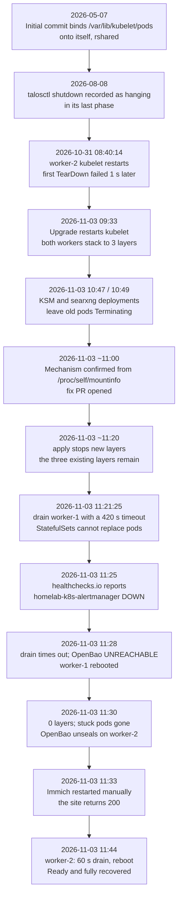

# 2026-11-03 — Pods stuck `Terminating`, and the 6-month-old mount that caused it

| | |
|---|---|
| **What happened** | A deleted pod stayed `Terminating` because a six-month-old `rshared` self-bind of `/var/lib/kubelet/pods` hid lower mount layers; a node drain turned it into an outage. |
| **Impact** | ~9 minutes of service unavailability (OpenBao, Immich, Vaultwarden, Pydio, Alertmanager); no data loss identified. |
| **What changed** | The mount patch was removed, two alert rules were added and backtested against this incident, and the drain SOP now caps at 60 s before rebooting. |

## Summary

A deleted pod stayed in `Terminating` because kubelet could not unmount its
volumes: `unlinkat ...: device or resource busy`. On both workers,
`/var/lib/kubelet/pods` was bind-mounted onto itself with `rshared` propagation in
the Talos machine config. Every kubelet restart added another layer; each layer
carried a copy of every pod volume. kubelet unmounts a volume once and then removes
the directory, so the hidden lower copies kept it a mount point and the removal
failed forever.

The bug had been in the config since the initial commit on 2026-05-07 — about **six
months** — and had already been misdiagnosed as a set of unrelated known quirks.
On 2026-11-03 a node drain turned it into an outage: StatefulSet pods could not be
replaced, and OpenBao, Immich, Vaultwarden, Pydio and Alertmanager were unavailable
for roughly nine minutes.

## Impact

| Item | Detail |
|---|---|
| Main window | 11:21–11:33 UTC |
| Secondary window | 11:39–11:44 UTC, 1–3 minutes while worker-2 rebooted (per-service impact not individually measured) |
| Services | OpenBao (`OpenBao UNREACHABLE` alert), Immich (503), Vaultwarden, Pydio, Alertmanager (~8 minutes) |
| Monitoring | vlsingle/vmsingle down but **no data gaps**: metrics and logs have samples for every minute (agents buffered and backfilled); only the down pods' own scrape targets are missing |
| Data loss | None identified |
| Root cause present | 2026-05-07 → 2026-11-03 |

## Timeline (UTC)



| Time | Event |
|---|---|
| 2026-05-07 | Initial commit adds worker `kubelet.extraMounts`: `/var/lib/kubelet/pods` bound to itself, `["bind","rshared","rw"]`, annotated as required for NFS CSI propagation |
| 2026-08-08 | `talosctl shutdown` is recorded as hanging in its last phase; filed as a known side effect of that mount |
| 2026-10-31 08:40:14 | worker-2 kubelet restarts; 1 second later the first 10 `TearDown failed` lines appear. Nobody notices |
| 2026-11-03 09:33–09:52 | Talos/Kubernetes upgrade causes repeated kubelet restarts; both workers stack to **3 layers**. Worker upgrades require `--stage`; four stuck DaemonSet pods are force-deleted and misdiagnosed as "kubelet does not recognise old pods after a reboot" |
| 10:47 / 10:49 | Deployments of KSM and searxng leave old pods `Terminating` → investigation starts |
| ~11:00 | Mechanism confirmed from `/proc/self/mountinfo`; fix PR opened |
| ~11:20 | `terraform apply` stops new layers from being added, but the three existing layers are still on both workers |
| **11:21:25** | `drain worker-1` with a 420-second timeout. StatefulSet pods are evicted, their old pods cannot finish, replacements cannot be created → outage |
| 11:25 | healthchecks.io reports `homelab-k8s-alertmanager` DOWN (last ping ~11:19) — the external dead-man check working |
| ~11:28 | Drain times out; user reports `OpenBao UNREACHABLE` |
| 11:28:34 | worker-1 rebooted; Ready in ~70 seconds, no half-shutdown |
| ~11:30 | 0 layers; stuck pods gone; `openbao-0` unseals on worker-2; OpenBao health check passes at 11:30:03 |
| ~11:33 | Immich CrashLoops because the database was not ready; manual restart, Immich returns 200 |
| 11:39–11:44 | worker-2: scale bmc2 to 0, drain **60 seconds only**, reboot, Ready in ~70 seconds; fully recovered |

## Root cause

```
machine config: kubelet.extraMounts  /var/lib/kubelet/pods -> itself, rshared
  -> every kubelet restart re-applies it: one more stacked peer mount
  -> rshared propagates each pod volume into every layer (3 layers ≈ 6 copies)
  -> kubelet deletes a pod: unmount once, then rmdir
  -> the hidden lower copy still makes the path a mount point -> EBUSY, retried every ~2 minutes
  -> the pod never disappears; a StatefulSet will not create its replacement
```

- `doCleanupMountPoint` unmounts once and calls `os.Remove`. The kernel returns
  `EBUSY` for a directory that is still a mount point — including mounts hidden
  from the path by an upper layer — so retrying cannot succeed.
- It was not limited to projected volumes: `emptyDir` and Proxmox CSI disks were
  affected too.
- It stayed latent because layers are only added when kubelet restarts, and only
  *deleted* pods are affected. Pods are rarely deleted here, so the 2026-10-31
  failures sat in the log unread.

**Contributing factors**

1. No alert existed for teardown failures or for pods Terminating too long.
2. The docs had rationalised the symptoms: `--stage` worker upgrades, half-shutdowns
   and occasional stuck pods were written up as "known costs" of a mount that was
   claimed to be an NFS CSI prerequisite. A single line of Talos source (which
   already bind-mounts all of `/var/lib/kubelet` with `rshared`) disproved the
   prerequisite.
3. `drain` *is* a batch restart of StatefulSets; the plan said "do not restart the
   StatefulSets" and then did exactly that, waiting 420 seconds for pods that could
   never terminate.
4. `kubectl delete --force` removes the API object but leaves the mount on the node.

## What went well

- The external dead-man check did its job: at 11:25 healthchecks.io went DOWN even
  though Alertmanager itself was one of the things that had stopped.
- The fix was bounded and reversible: remove the patch, reboot to clear the existing
  layers, verify with a canary pod that both NFS (read) and Proxmox CSI (write/read/
  delete) still work with exactly one mount each and zero residue.
- Recovery per node was ~70 seconds once the decision to reboot was made.
- The follow-up alert rules were **backtested against this incident** before merge
  (see below), not just written.
- A control experiment removed `nfs-primer` (an earlier workaround for NFS `EPERM`
  on first mount) and confirmed zero `EPERM` after a reboot and a kubelet restart.

## What went poorly

- **Six months of latent breakage**, with three separate symptoms being worked
  around rather than one cause being found.
- **A wrong explanation was written into the runbooks.** The force-delete advice
  would have left mounts behind on every future upgrade.
- A known symptom was allowed to become an outage: the drain waited the full
  timeout instead of rebooting after 60 seconds.
- Nothing in monitoring noticed `TearDown failed` before a human did.

## Action items

| # | Action | Status |
|---|---|---|
| 1 | Remove `kubelet.extraMounts` from workers; reboot both to clear existing layers; canary-verify NFS and Proxmox CSI mounts (1 copy each, 0 residue) | **Done** 2026-11-03 |
| 2 | Add `PodStuckTerminating` (deletion older than 15 min, `for: 5m`) and `KubeletVolumeTeardownFailing` (unmount failures sustained 15 min) | **Done** 2026-11-03 |
| 3 | Backtest both rules over the 7 days to 2026-11-03 at 1-minute resolution: `PodStuckTerminating` would have fired at 11:10 (pods deleted 10:47/10:49); `KubeletVolumeTeardownFailing` at ~10:08 (worker-1) and ~10:09 (worker-2); three legitimate reboot bursts in 7 days stay below `for: 15m` | **Done** — documented in `examples/monitoring/pod-termination-alerts.yaml` |
| 4 | SOP: when a deleted pod is stuck Terminating, do not let drain wait — `--timeout=60s`, then reboot the node; the pod rebuilds elsewhere | **Done** |
| 5 | Remove `nfs-primer` and its Ansible fallback; verify first NFS mount and post-kubelet-restart mount with 0 `EPERM` | **Done** 2026-11-03 |
| 6 | Correct `stages.md`: the stuck DaemonSet pods were mount layers, not "kubelet does not recognise old pods after reboot" | **Done** |
| 7 | Validate the fix at the next upgrade: both workers upgrade **without** `--stage`, drains of 40 s and 36 s, no stuck pods, 0 layers | **Done** 2026-11-04 |
