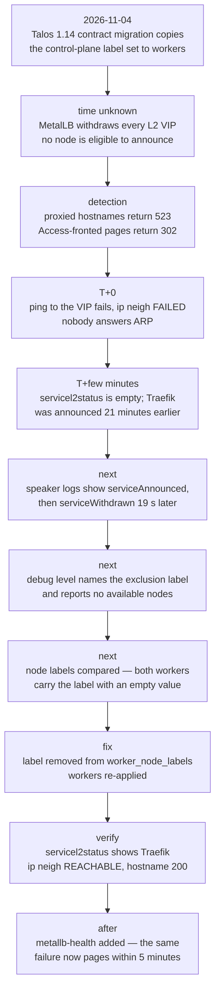

# 2026-11-04 — MetalLB withdrew every VIP; every proxied host returned 523

| | |
|---|---|
| **What happened** | The Talos 1.14 migration copied the control-plane label set to workers, including `node.kubernetes.io/exclude-from-external-load-balancers`; MetalLB excludes on the label's presence, so no node was eligible and every L2 VIP was withdrawn. |
| **Impact** | Every Cloudflare-proxied hostname returned 523; Access-fronted pages returned 302 from the edge. Duration not recorded — roughly 20 minutes before detection. Pods and Traefik stayed healthy. |
| **What changed** | The label was removed from the worker label set; a five-minute `metallb-health` check now pages; the post-change checklist compares resulting node labels, not just config values. |

## Summary

Every hostname behind the Cloudflare Tunnel began returning **523** ("origin
unreachable") at once, while hosts behind Cloudflare Access still returned 302.
Inside the cluster, pods and Traefik were healthy. MetalLB was not announcing the
VIPs: no node was eligible to announce them.

The cause was a label. During the Talos 1.14 machine-config migration, the
control-plane `KubeNodeConfig` label set was copied to the workers. That set
includes `node.kubernetes.io/exclude-from-external-load-balancers`, which the 1.14
renderer puts on control planes only. MetalLB checks for the label's **presence, not
its value**, so every node was excluded, the candidate set became empty, and all L2
VIPs were withdrawn.

## Impact

| Item | Detail |
|---|---|
| Public HTTP | Every Cloudflare-proxied hostname: 523. No origin reachable |
| LAN | All L2 VIP services unreachable: ARP for the Traefik VIP failed from the tunnel host |
| Cloudflare Access hosts | 302 from the edge only — proof the edge was alive and the origin was not, not proof the service worked |
| Internal cluster traffic | Unaffected: pods and Traefik were healthy throughout |
| Duration | **Not recorded.** The withdrawal preceded detection by roughly 20 minutes; the exact start and end were not captured |

## Timeline



| Time | Event |
|---|---|
| 2026-11-04 | Talos 1.14 contract migration applies worker labels copied from the control-plane template |
| (time unknown) | MetalLB withdraws every VIP |
| (detection) | All proxied hostnames return 523; Access-fronted pages return 302 |
| +0 | `curl` from the tunnel host: `ping <VIP>` fails, `ip neigh` shows `FAILED` — no L2 responder, not a TCP filter |
| +few min | `kubectl get servicel2status -A` is empty; events show Traefik was announced by worker-2 **21 minutes earlier** |
| next | Speaker logs on the old pod show `serviceAnnounced`, then `serviceWithdrawn reason=notOwner` 19 seconds later; no node took over. Restarting the speaker and the controller changes nothing |
| next | Speaker log level patched to `debug`; the reason appears: `skipping should announce l2 ... speaker's node has labeled 'node.kubernetes.io/exclude-from-external-load-balancers'` and `no available nodes` |
| next | Node labels compared: both workers (and the control planes) carry the label with an empty value |
| fix | Label removed from `worker_node_labels`, workers re-applied; control planes keep it, matching upstream |
| verify | `servicel2status` shows Traefik on a worker; `ip neigh` is `REACHABLE`; a proxied hostname returns 200. Speaker args reverted to upstream and `kubectl diff` against the manifest is empty |

## Root cause

Talos 1.14 renders `KubeNodeConfig` with the exclusion label on control planes and
with no labels at all on workers. The migration reused the control-plane structure
for workers. MetalLB's eligibility check is:

```go
if _, ok := node.Labels["node.kubernetes.io/exclude-from-external-load-balancers"]; ok {
    // excluded — regardless of value
}
```

An empty value is still a present key. `speakersForAds` returned an empty set for
every service, so every VIP was withdrawn, and the proxied path had no origin to
reach.

Two details turned a config error into a confusing outage:

- **Access-fronted hosts answered 302.** That response comes from Cloudflare's edge
  and never touches the origin. A 302 read as "the page looks fine" was a false
  signal.
- **The VIP disappeared at L2.** `ping` failing with `ip neigh FAILED` looked like a
  network or firewall problem, but it was simply nobody answering ARP.

## What went well

- The first diagnostic split — edge response vs origin response — prevented an hour
  of debugging the cluster's healthy pods.
- Testing from **outside** the cluster (the tunnel host) made the L2 failure obvious;
  testing from a workstation routed elsewhere would not have.
- `servicel2status` plus events gave a precise, if negative, answer: nothing was
  announced, and here is when it stopped.
- The debug log named the exact condition, and the stopgap (`--ignore-exclude-lb`)
  restored service while the config fix was prepared. It was removed once the
  workers no longer carried the label; the permanent fix changed the config.
- A five-minute health check (`metallb-health`: speaker readiness + Traefik's
  `ServiceL2Status`) was added afterwards, so the same failure now pages within five
  minutes instead of waiting for a user.

## What went poorly

- **The migration copied control-plane config to workers.** "Same except where it
  must differ" was applied to a field whose whole purpose is to differ.
- Verification compared machine-config *values*, but never compared the resulting
  **node labels against MetalLB's eligibility rule**. The change was validated at the
  layer it was written, not at the layer that consumes it.
- No alert existed for "no VIP is announced". The outage was found by using the
  services.
- Diagnosing it required changing a DaemonSet's log level in a production cluster,
  which is itself a change with a rollback obligation.

## Action items

| # | Action | Status |
|---|---|---|
| 1 | Remove `node.kubernetes.io/exclude-from-external-load-balancers` from `worker_node_labels`; keep it on control planes, matching the 1.14 renderer | **Done** |
| 2 | Revert speaker args to upstream (`--port=9120 --log-level=info`); `kubectl diff` against the MetalLB manifest empty | **Done** |
| 3 | Add `tools/metallb-health`: every 5 minutes, speaker readiness plus Traefik's `ServiceL2Status`; alert to Telegram. Deliberately does not compare total Service count (palworld is intentionally at 0 replicas) | **Done** |
| 4 | Document that control-plane labels/taints must never be copied to workers, and that `IPAddressPool` has no `nodeSelectors`: node selection is `L2Advertisement.spec.nodeSelectors` in L2 mode (BGP uses `BGPAdvertisement.spec.nodeSelectors`) | **Done** |
| 5 | In the post-change checklist: inspect node labels/taints with two independent commands (`talosctl get nodelabelspecs` and `get nodetaintspecs`), not by dumping the whole machine config | **Done** |
