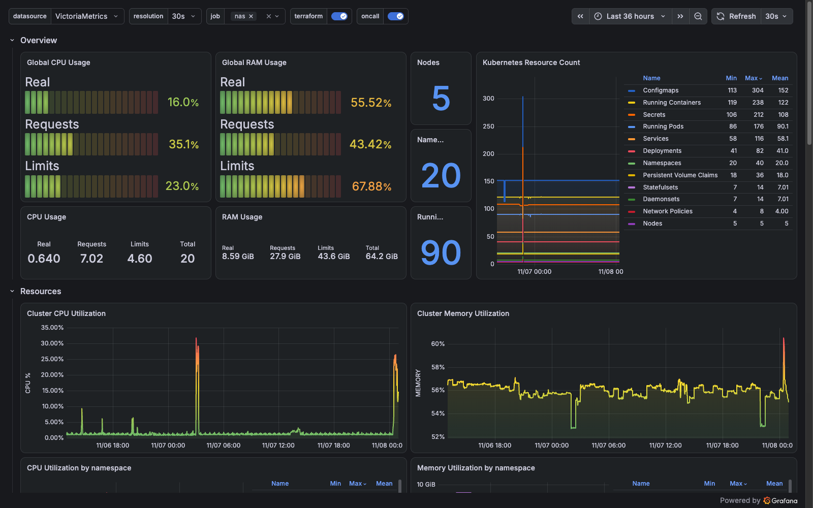
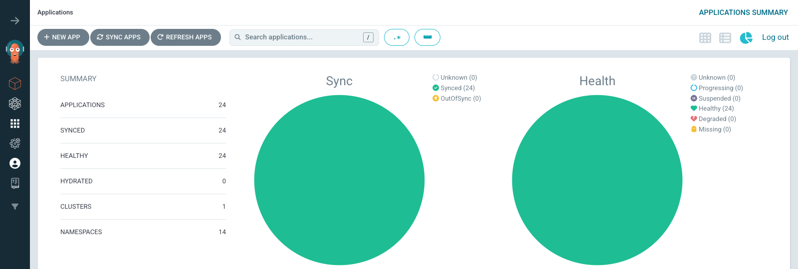
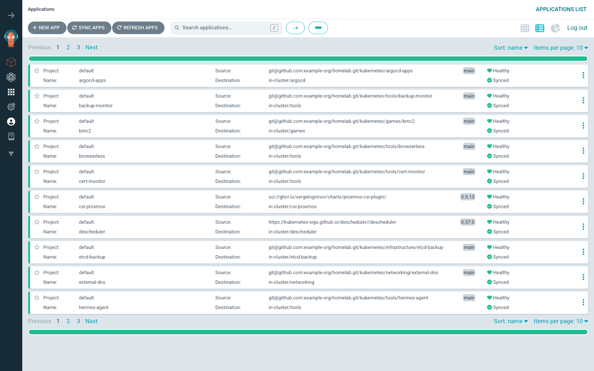
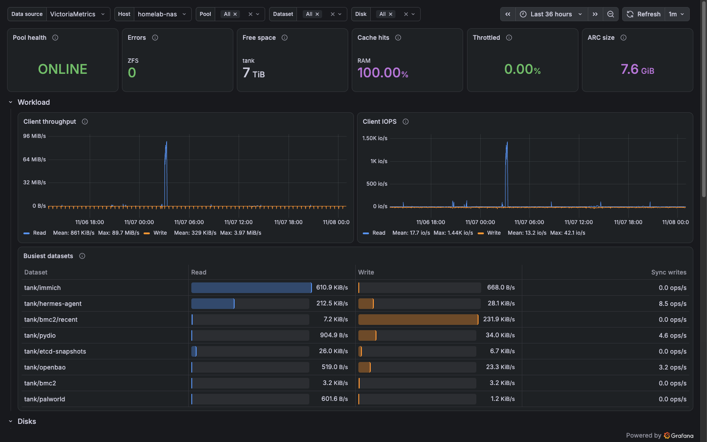
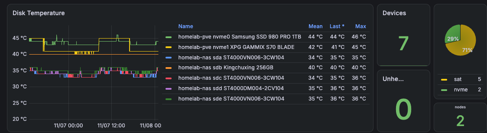
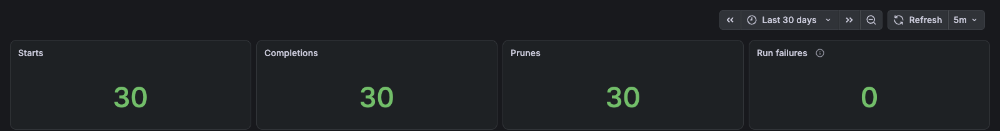
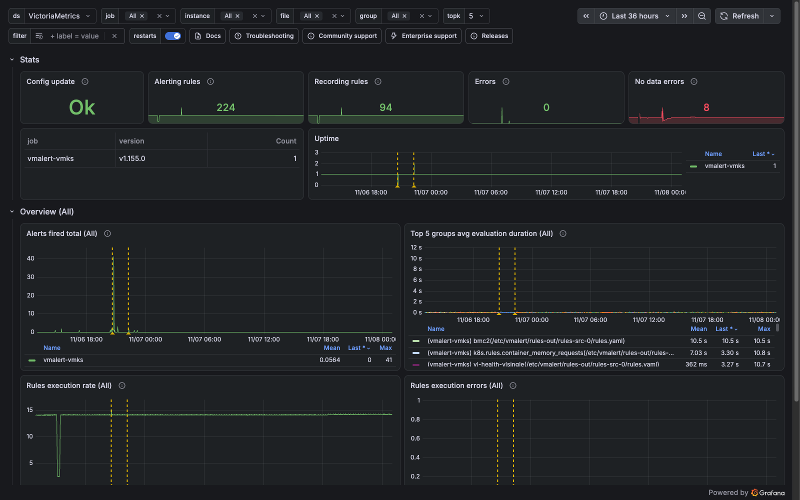
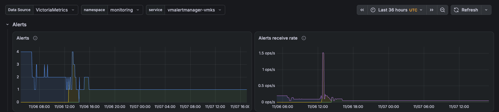
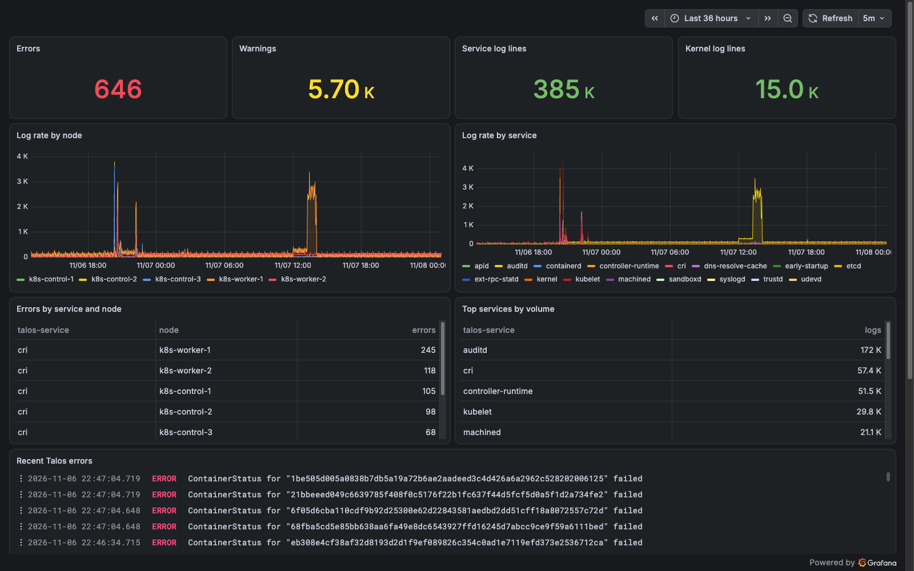

# Screenshots

Captured from the live system on 2026-11-08. Metric and log dashboards show the
last 36 hours; the backup summary shows the last 30 days. Before capture,
addresses and identifiers on the page were replaced in the browser with the same
placeholders the rest of this repository uses; disk serial numbers were cropped
out. Nothing else was edited. Captions describe only what is on screen plus facts
documented elsewhere in this repository.

## Cluster overview



Five Talos nodes, 20 namespaces, 90 running pods, with real usage, requests and
limits side by side for CPU and memory.

## GitOps state





24 Applications (23 services plus the app-of-apps root), all `Synced` and
`Healthy`. Auto-sync is intentionally off; see
[ADR 0002](decisions/0002-argocd-manual-sync.md).

## Storage



The NAS pool: `ONLINE`, zero ZFS errors, 7 TiB free, a 7.6 GiB ARC serving all
reads from RAM, and per-dataset read/write load.



Seven disks on two hosts, zero unhealthy. SMART attributes feed the disk alert
rules, including the cable-error rule that needed a 48-hour identity-stability
window to stop a false positive.

## Backups



Thirty nightly restic runs in 30 days: thirty completions, thirty prunes, zero
failures. Restores are proved separately by timed drills (see the README).

## Alerting



224 alerting rules and 94 recording rules across 61 groups, zero evaluation
errors.



Alertmanager's view of the same window. Alerts are delivered to Telegram; the
in-cluster path is backed by an out-of-band NAS poller and a healthchecks.io
dead-man switch.

Message templates used by the out-of-band checks and the backup job (templates,
not a screenshot):

```
❌ <check> failing for <N> min<detail> (seen from <HOST>)
⏰ <check> still failing — <N> min<detail> (seen from <HOST>)
✅ <check> recovered<detail> (seen from <HOST>)
⚠️ Restic repo on <HOST> shrank to <PCT>% of its previous size (<prev> → <now>).
✅ Weekly backup summary — <HOST> · Snapshots: <N> · Integrity check (5% of data): passed
```

## Logs



Talos cannot ship logs off the node by itself, so every node pushes service and
kernel logs to an in-cluster Vector relay, broken down here by node and by Talos
service.
